# OpenLR on stacked roads in Tokyo: across maps, and against linestring map matching

A self-contained Python demonstrator that encodes routes as **OpenLR line locations**
(following the [OpenLR whitepaper v1.5](https://download.tomtom.com/open/banners/openlr-whitepaper_v1.5.pdf))
and decodes them on **OpenStreetMap**. It compares OpenLR with three linestring-based
matchers: nearest-road snapping, an HMM map matcher and the
[Mapbox Map Matching API](https://docs.mapbox.com/api/navigation/map-matching/) (optionally on
ZENRIN data through a custom profile). The test routes are on roads that are stacked on top of
each other in Shibuya, Tokyo:

* **Shuto Expressway No. 3** (elevated, OSM `layer` +3/+4) directly above **National Route 246**
  (ground level, partly in a tunnel), and
* the **Shuto C2 Yamate Tunnel** (`layer` -2) directly below **Yamate-dori**.

In plan view, the upper and lower roads are only a few metres apart, so a route's geometry
alone cannot tell them apart. OpenLR also transmits road class (FRC), form of way (FOW),
bearing, distances and the lowest road class allowed between the points. These attributes
let the decoder find the correct level.

The demonstrator has two parts:

* **Split view, OSM → OpenLR → Mapbox** (`openlr-demo serve`, page `/`). On the left you draw a
  route on OpenStreetMap; [Valhalla](https://valhalla.github.io/valhalla/) routes it and the
  demo encodes it as OpenLR. On the right the same OpenLR code is decoded on the Mapbox map
  (ZENRIN routing profile), and the two routes are compared: accuracy line by line, and
  geometric and attribute similarity. Encoder and decoder maps are genuinely different here.
* **Linestring comparison** (page `/compare`, `openlr-demo run`, `sweep`). OpenLR against three
  linestring matchers on a simulated second map, described from
  [Result in one table](#result-in-one-table) on.

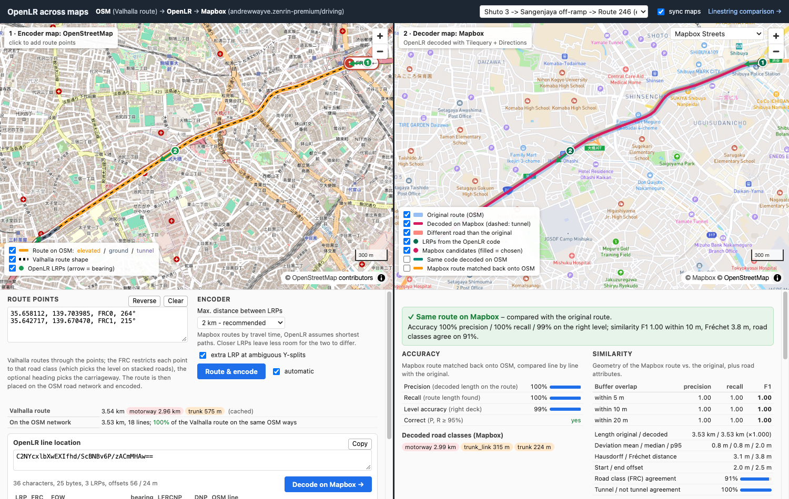

## Split view: OSM → OpenLR → Mapbox

**Left: encoder map (OpenStreetMap).**

1. Click the map to add route points, or type them as `lat, lon, FRC, heading` (FRC and
   heading are optional). On stacked roads, a click lists every road within 40 m: its class
   (FRC), its level and, for one-way roads, its direction. Pick the road you mean.

   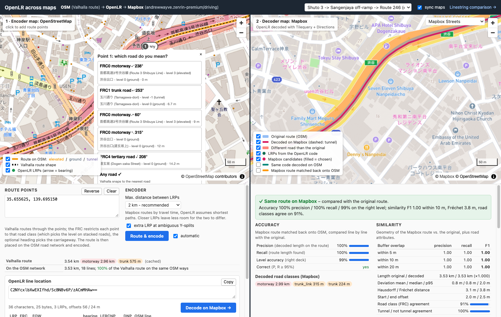

2. [Valhalla](https://valhalla.github.io/valhalla/) routes through the points. The FRC
   becomes a `search_filter` on Valhalla's road class, which picks the level. The heading
   picks the carriageway.
3. The Valhalla route is placed on the bundled OSM network: an HMM over the densified shape,
   guided by the OSM way IDs that Valhalla returns. The panel shows how much of the route
   lies on the same OSM ways (100 % for all examples).
4. The OSM path is encoded as an OpenLR line location (whitepaper encoder, below). The panel
   shows the code, the LRP table and the encoder log. The code box is editable, so you can
   paste any OpenLR line location and decode it.

**Right: decoder map (Mapbox, ZENRIN profile).** The OpenLR code is decoded without OSM
(see [Decoding on Mapbox](#decoding-on-mapbox-mapbox_decoderpy)). The map shows:

* the original route (blue) and the LRPs as received, with bearing arrows;
* the Mapbox candidates for each LRP, filled when chosen;
* the decoded route (magenta, dashed in tunnels);
* the roads that differ from the original, highlighted in red.

The panel shows a verdict, the metrics, the LRPs as read from the binary code, the candidate
and route-attempt tables with each check result, and the number of Mapbox API requests.
The basemap is Mapbox Streets, Satellite or Light. The tiles are fetched through the local
server, so the token stays there. Both maps move together (`sync maps`).

**Metrics.** *Accuracy*: the Mapbox route is matched back onto OSM (Mapbox returns no OSM
IDs) and compared line by line with the original OSM path:

* length-weighted precision and recall;
* the share on the right level;
* correct, when precision and recall are both at least 95 %.

*Similarity* compares the two geometries directly:

* buffer precision, recall and F1 within 5, 10 and 20 m;
* mean, median and 95th-percentile deviation;
* Hausdorff and discrete Fréchet distance (the latter respects the direction of travel);
* length ratio and start/end offsets;
* road-class and tunnel agreement: for every 2 m of the original, the nearest decoded piece
  within 25 m.

Geometry alone cannot separate stacked roads, so the routes count as *similar* only if:

* F1 within 10 m is at least 0.9;
* the Fréchet distance is at most 30 m;
* the road classes agree on at least 75 %.

Without an original route (a pasted code), the reference is the same code decoded on OSM.

**Results** (`openlr-demo crossmap` writes `output/crossmap.md`). All six scenarios are
encoded on OSM and decoded on `andrewwayve.zenrin-premium/driving`. The maximum distance
between LRPs is either the whitepaper's 15 km or the split view's default of 2 km:

| scenario | 15 km: LRPs | result | P / R | F1 @ 10 m | Fréchet | FRC agr. | 2 km: LRPs | result | P / R | Fréchet |
|---|---|---|---|---|---|---|---|---|---|---|
| Shuto 3, elevated | 2 | correct | 1.00 / 1.00 | 1.00 | 3.8 m | 100 % | 3 | correct | 1.00 / 1.00 | 3.3 m |
| Shuto 3 → Sangenjaya exit | 2 | **wrong** | 0.24 / 0.24 | 0.93 | 12.2 m | 23 % | 3 | correct | 1.00 / 1.00 | 3.9 m |
| Route 246, below Shuto 3 | 2 | correct | 1.00 / 1.00 | 1.00 | 9.0 m | 100 % | 3 | correct | 1.00 / 1.00 | 7.5 m |
| C2 Yamate Tunnel | 2 | correct | 1.00 / 1.00 | 0.99 | 11.6 m | 100 % | 3 | correct | 1.00 / 1.00 | 11.0 m |
| Yamate-dori, above C2 | 2 | correct | 1.00 / 1.00 | 1.00 | 4.6 m | 100 % | 2 | correct | 1.00 / 1.00 | 4.6 m |
| Route 246 → Ikejiri on-ramp → Shuto 3 | 2 | correct | 1.00 / 1.00 | 0.97 | 12.5 m | 81 % | 3 | correct | 1.00 / 1.00 | 12.5 m |

The 81 % road-class agreement on the ramp route is a classification difference. OSM tags the
Ikejiri on-ramp `motorway_link` (FRC0), while Mapbox reports it as `trunk_link` (FRC1).

**Fastest vs. shortest path.** The one failure is instructive. The
code `C2NYcxlbXwE3PfKc+ecKYwMB` has two LRPs 3.6 km apart: *FRC0 MOTORWAY, bearing 266°,
LFRCNP FRC1* on Shuto 3, and *FRC1* on Route 246 after the Sangenjaya exit. The OpenLR
encoder guarantees that the location is the **shortest** path between the LRPs on its own
map. Mapbox Directions returns the **fastest** route under its own cost model. That route
leaves the viaduct at the Shibuya exit after about 650 m and follows Route 246 below. It has
practically the same length (3614 m against a DNP of 3604 m), starts on a motorway and uses
nothing below FRC1, so it passes every check OpenLR defines. Mapbox also returns no alternative route for this
pair. With LRPs at most 2 km apart, the third LRP sits on the viaduct beyond the Shibuya
exit, and the route is decoded correctly. That costs 7 more bytes (25 instead of 18; 36
instead of 24 base64 characters).

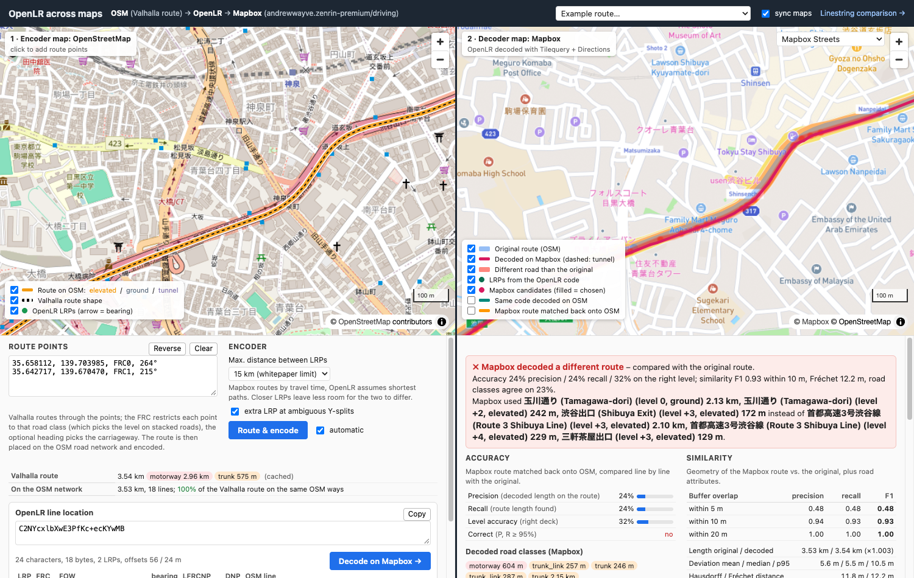

**API usage.** Decoding a code with *n* LRPs takes:

* *n* Tilequery requests;
* *n − 1* Directions requests, plus retries when a candidate pair fails a check (at most 30).

Responses are cached in `output/.cache/mapbox/`, so repeating a route makes no new
requests. The full `crossmap` run (12 decodes) needs 31 requests the first time. Valhalla's public
server (FOSSGIS) is used at most once per second, with two requests per route (`/route`,
`/trace_attributes`), also cached. Set `VALHALLA_URL` to use your own instance.

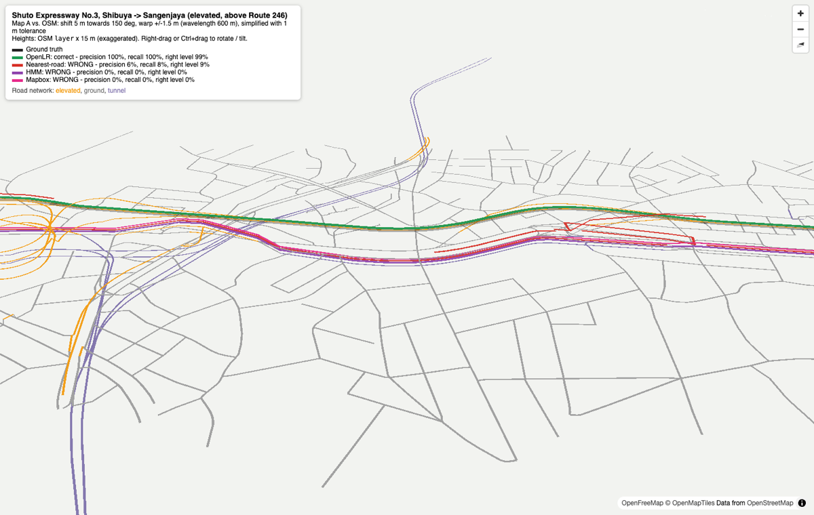

## Result in one table

The sending map ("map A") is OSM with a 5 m systematic offset, a ±1.5 m warp and 1 m
Douglas–Peucker generalisation. Each route is transmitted once as OpenLR and once as a
linestring, then matched onto OSM. A route counts as correct when length-weighted
precision and recall are both at least 90 %.

| scenario | OpenLR | nearest-road snapping | HMM map matching | Mapbox (ZENRIN) |
|---|---|---|---|---|
| Shuto 3, elevated (above Route 246) | **correct** | wrong (9 % on right level) | wrong (0 % on right level) | wrong (0 %) |
| Shuto 3 → Sangenjaya off-ramp → Route 246 | **correct** | wrong (18 %) | wrong (10 %) | wrong (10 %) |
| Route 246, below Shuto 3 | **correct** | wrong (71 %) | wrong (75 %) | wrong (75 %) |
| C2 Yamate Tunnel, below Yamate-dori | **correct** | correct | correct | wrong (0 %) |
| Yamate-dori, above C2 | **correct** | wrong (59 %) | correct | correct |
| Route 246 → Ikejiri on-ramp → Shuto 3 | **correct** | wrong (45 %) | wrong (31 %) | wrong (31 %) |

Mapbox here is the custom profile `andrewwayve.zenrin-premium/driving`. With identical maps
(no offset, warp or generalisation) it matches all six routes correctly, so the failures
above come from the 5 m map difference and not from the evaluation.

Each OpenLR reference is 2 location reference points, 24 base64 characters, e.g.
`C2NYdRlbXgEXM/Sh+ykBZQQC` for the 2.9 km on Shuto 3.

The robustness sweep below varies the offset from 0 to 20 m in 12 directions, always with
the ±1.5 m warp and 1 m generalisation; each point is 72 runs. OpenLR decodes every route
correctly. HMM matching is perfect up to a 2 m offset and then drops. Mapbox behaves much
like the HMM, but already gets 12 % wrong at a 0 m offset: on the ramp route it stays on
Route 246 instead of taking the on-ramp in 8 of 12 runs, and it puts one C2 run onto
Yamate-dori. Nearest-road snapping fails on more than a third of the routes even at a 0 m
offset, where only the warp and generalisation differ.

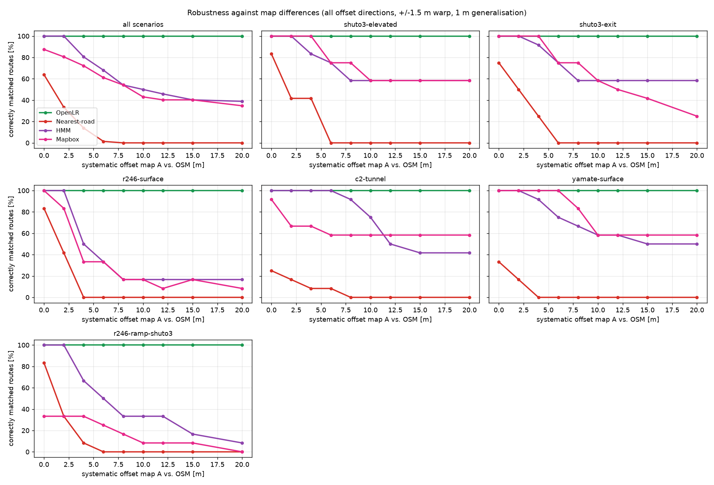

| systematic offset | 0 m | 2 m | 4 m | 6 m | 8 m | 10 m | 12 m | 15 m | 20 m |
|---|---|---|---|---|---|---|---|---|---|
| OpenLR | 100 % | 100 % | 100 % | 100 % | 100 % | 100 % | 100 % | 100 % | 100 % |
| nearest-road | 64 % | 33 % | 14 % | 1 % | 0 % | 0 % | 0 % | 0 % | 0 % |
| HMM | 100 % | 100 % | 81 % | 68 % | 54 % | 50 % | 46 % | 40 % | 39 % |
| Mapbox (ZENRIN) | 88 % | 81 % | 72 % | 61 % | 54 % | 43 % | 40 % | 40 % | 35 % |

## Quick start

Requires Python ≥ 3.11 (uv downloads one if needed). Everything stays in this folder: the
OSM extract is bundled in `data/`, and outputs go to `output/`. The HTML maps load their
basemap and JavaScript libraries from the internet when opened.

With [uv](https://docs.astral.sh/uv/) (`brew install uv`):

```bash
uv sync
uv run openlr-demo serve      # browser app on http://localhost:8765/ (split view; /compare)
uv run openlr-demo crossmap   # scenarios: OSM -> OpenLR -> Mapbox, output/crossmap.md (needs a token)
uv run openlr-demo run        # all scenarios: console report, maps, output/report.md
uv run openlr-demo sweep      # robustness sweep: output/sweep.csv + sweep.png (~45 s)
uv run pytest
```

With [Poetry](https://python-poetry.org/) ≥ 2.0:

```bash
poetry install
poetry run openlr-demo serve
poetry run openlr-demo run
poetry run pytest
```

### Mapbox (optional)

Without a token, everything runs and Mapbox is simply left out. To include it, copy
`.env.example` to `.env` (git-ignored) and fill in:

```bash
MAPBOX_ACCESS_TOKEN=pk....
MAPBOX_PROFILE=andrewwayve.zenrin-premium/driving   # or mapbox/driving
MAPBOX_RADIUS=20                                    # search radius per point [m]
VALHALLA_URL=https://valhalla1.openstreetmap.de     # routing for the split view (default)
```

The split view needs Mapbox for its right half; without a token, the left half still routes
and encodes. Environment variables of the same name take precedence over `.env`. A profile without a
slash gets `/driving` appended. The custom profile URL form is
`<account>.zenrin-premium/driving`; `<account>/zenrin-premium` returns 404. The token is
only sent to `api.mapbox.com`. It is never written to reports, maps or the response cache in
`output/.cache/mapbox/`, and the browser never sees it: all requests go through the local
server.

`openlr-demo run` and `serve` use Mapbox when a token is configured (`--no-mapbox` turns it
off). `sweep` only does so with `--mapbox`, because that is 540 requests; the API allows 300
per minute, and the client sends at most 4 per second. Responses are cached, so a repeated
run makes no requests.

## Linestring comparison in the browser (`/compare`)

`openlr-demo serve` starts a local web server (bound to 127.0.0.1) and opens the split view
described above. The link *Linestring comparison* at the top right opens this page:

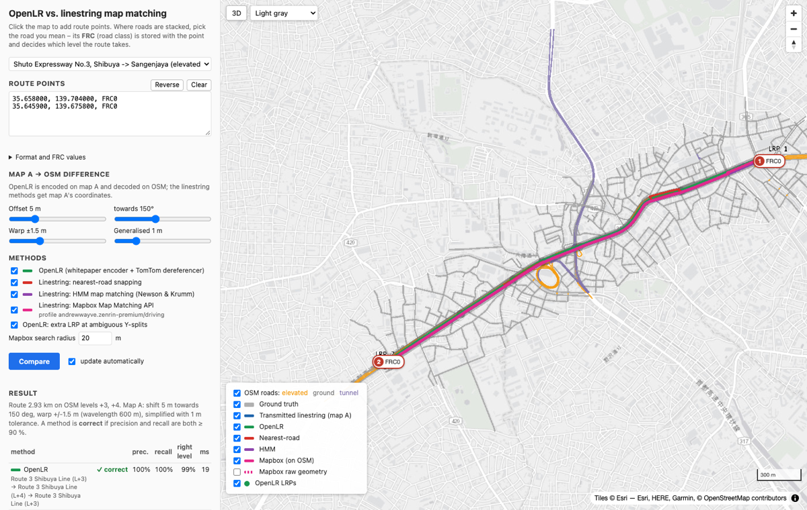

* **Enter a route** by clicking the map, or by typing or pasting points into the text box,
  one per line as `lat, lon, FRC` (e.g. `35.65720, 139.70050, FRC1`). The FRC is optional.
  `lon,lat` pairs (detected by value) and Mapbox-style `lon,lat;lon,lat` lists also work.
  The examples menu loads the six scenarios.
* **Pick the road with the FRC.** Where roads are stacked, a click lists every road class
  within 40 m with its name and level. The chosen FRC is stored with the point and shown on
  its marker. Click a marker later to change its FRC or delete it, or drag it to move it.

  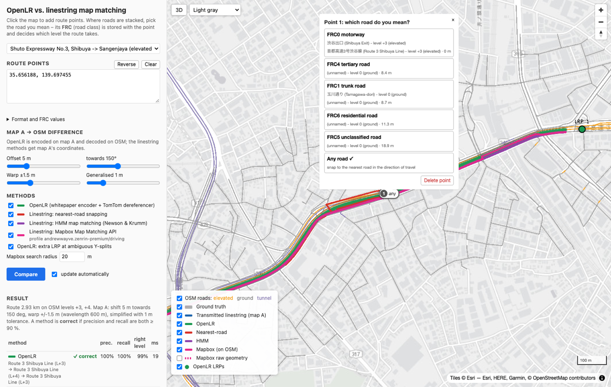

* **Ground truth** is the shortest path through the points on OSM. Each point snaps to a
  road of its FRC heading towards the next point, and between two points only roads with an
  FRC between the two points' FRCs are used (relaxed, with a note, if there is no such path).
  The same two coordinates therefore give Shuto 3 with FRC0 and Route 246 with FRC1.
* **Map A** is set with the sliders (offset, direction, warp, generalisation). The route is
  then encoded as OpenLR on map A and decoded on OSM, while the linestring matchers get map
  A's coordinates, as in the CLI. Results update automatically; Ctrl/Cmd+Enter runs
  immediately.
* **Results** show, per method, correct or wrong, precision, recall, the share on the right
  level and the roads used, plus a level profile. You also get the OpenLR code (with copy
  button), its LRP table and encoder log, and what Mapbox answered: the road classes along
  its match and its confidence. On the map, the legend toggles every layer, clicking an LRP
  shows the decoder's candidate lines, and **3D** shows roads at their OSM layer height.
* The URL keeps the points (`#p=lat,lon,frc;...`), so a route can be bookmarked or shared.

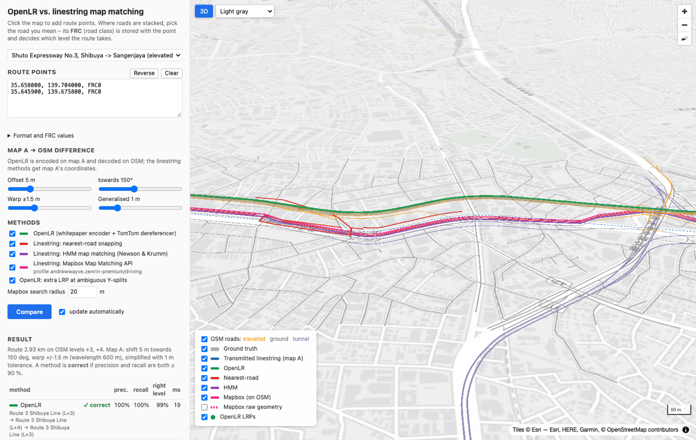

Then open `output/report.md`, or one of the interactive maps:

* `output/<scenario>/map.html`: a 2D Leaflet map. You can switch between basemaps
  (including satellite imagery, where the viaduct is visible) and toggle the road network
  coloured by level, the ground truth, the transmitted linestring and each method's
  result. Click an LRP to see its attributes and the decoder's candidate lines. The layer
  "Mapbox raw answer" shows Mapbox's own geometry, with its road class per segment.
* `output/<scenario>/map3d.html`: a deck.gl 3D view in which every road is drawn at OSM
  `layer` × 15 m. Right-drag or Ctrl+drag to rotate and tilt.
* `output/<scenario>/level_profile.png`: the level each method chose along the route.

In 2D, the four results for Shuto 3 lie on top of each other:

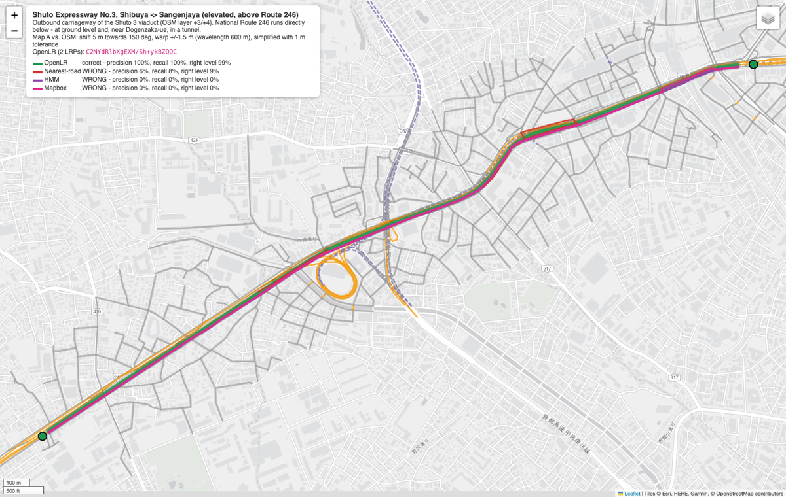

The level profile shows that they are not on the same road:

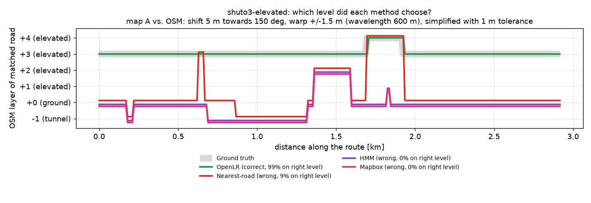

### Commands

| command | what it does |
|---|---|
| `openlr-demo serve` | Browser app on `http://localhost:8765/`: split view at `/`, linestring comparison at `/compare` (`--port`, `--host`, `--no-browser`, `--no-mapbox`). |
| `openlr-demo crossmap [-s KEY ...]` | Encodes the scenarios on OSM, decodes them on Mapbox and writes `output/crossmap.md` (`--lrp-distance 15000 2000`: one run per maximum LRP distance; `--no-disambiguation`). |
| `openlr-demo run [-s KEY ...]` | Runs one or all scenarios. Options: `--shift`, `--bearing`, `--warp`, `--wavelength`, `--simplify` and `--seed` set the map difference; `--no-disambiguation` turns off the extra LRPs at Y-splits; `--no-mapbox` and `--mapbox-radius` control Mapbox; `--no-html` prints to the console only. |
| `openlr-demo sweep` | Success rate against offset (`--shifts 0 5 10`, `--directions 12`; `--mapbox` includes Mapbox, ~3 min the first time). |
| `openlr-demo scenarios` | Lists the test routes. |
| `openlr-demo fetch-data` | Rebuilds `data/shibuya_osm.json.gz` from a fresh PBF (BBBike Tokyo by default; `--url`, `--bbox`). |

Running `openlr-demo` with no command is the same as `openlr-demo run`.

## How it works

```
             map A (sender)                                    OSM (receiver)
  route ──► OpenLR encoder (whitepaper 11.1) ── base64 ──► openlr-dereferencer ──► path
       └──► coordinates (linestring) ─────────────────────► nearest / HMM matcher ──► path
                                     └────────────────────► Mapbox Map Matching ──► path (via HMM onto OSM)
                                                                     compare with ground truth
```

### Two different maps

OpenLR exists to transfer locations between *different* maps. The demo therefore encodes on
"map A" and decodes on OSM. Map A is derived from OSM (`sender_map.py`) with:

* a systematic offset (`--shift`, `--bearing`), as between two map vendors or datums;
* a smooth sinusoidal warp (`--warp`, `--wavelength`), as from digitisation differences;
* Douglas–Peucker generalisation (`--simplify`).

Topology and line IDs stay identical, which means the ground truth on OSM is known exactly.

### Network model (`network.py`)

OSM ways are split at junctions into directed lines; one-way roads, motorways, links and
roundabouts produce a single direction. Following the whitepaper, FRC and FOW are derived
from the OSM tags:

* **FRC:** motorway 0, trunk 1, primary 2, secondary 3, tertiary 4, unclassified 5,
  residential 6, others 7; `*_link` roads take their parent road's class.
* **FOW:** motorway → MOTORWAY, `*_link` → SLIPROAD, roundabout → ROUNDABOUT, one-way
  trunk/primary/secondary → MULTIPLE_CARRIAGEWAY, all others → SINGLE_CARRIAGEWAY.

The vertical level comes from `layer`; bridges default to +1 and tunnels to -1. The level is
used only for evaluation and display, never by any of the matchers.

### Encoder (`encoder.py`): whitepaper section 11.1

| step | implementation |
|---|---|
| 1 Check validity | The lines must be connected, and the offsets shorter than the location. |
| 2 Valid nodes (Rule 4) | The start and end are extended to the next valid node, i.e. not 1-in/1-out or 2-in/2-out with two neighbours. The added length becomes offset. |
| 3–7 Shortest-path coverage | Dijkstra from the current start line to the end line. Where the shortest path leaves the location, an intermediate LRP is inserted, moved back to a valid node if possible. |
| 8 Critical situations | If the line of an LRP has a twin at the same node (same FRC and FOW, bearing within 22.5°, e.g. a Y-split into two slip roads), an extra LRP is inserted right behind the split. This can be switched off with `--no-disambiguation`. |
| 9 Rule 1 | Extra LRPs keep consecutive LRPs at most 15 km apart, preferring valid nodes. |
| 9 Rule 5 | A first or last LRP whose path is entirely covered by an offset is removed. |
| 7, 10 LRP attributes and binary | COORD, FRC, FOW, BEAR (towards the point 20 m along the line, backwards for the last LRP), LFRCNP and DNP (Rule 2: integer metres). Encoded as binary version 3 with TomTom's [`openlr`](https://github.com/tomtom-international/openlr-python) package. |

The `report.md` lists every encoder step that fired for each scenario, plus the LRP table.

### Decoder (`decoder.py`)

TomTom's [`openlr-dereferencer`](https://github.com/tomtom-international/openlr-dereferencer-python)
implements the whitepaper decoder: candidate lines per LRP, scored by distance, FRC, FOW
and bearing; a shortest path between candidates restricted by LFRCNP; a DNP check;
backtracking; and offset trimming. The demo only adds a `MapReader` adapter for the
network. Its configuration uses a 50 m search radius, DNP tolerance of 10 % + 30 m, one FRC
of LFRCNP slack, and equal weights.

### Linestring baselines (`matchers.py`)

Both baselines receive the route geometry from map A (1e-5° ≈ 1 m precision) and nothing else.

* **Nearest-road snapping:** samples every 10 m and takes the nearest line with a compatible
  heading. On near-ties it prefers the previous line, removes single-sample blips and
  stitches the result with shortest paths.
* **HMM map matching** after Newson & Krumm (2009): Gaussian emission (σ = 5 m), exponential
  transition on |route distance − great-circle distance| (β = 10 m), and Viterbi decoding.
  This is the standard approach in, for example, OSRM, Valhalla and GraphHopper.

### Mapbox Map Matching (`mapbox.py`)

Mapbox receives the same map A coordinates as the other linestring matchers. A route
longer than the API limit of 100 coordinates is generalised to fit. The request uses
`geometries=geojson`, `overview=full`, `steps=true`, `tidy=false` and a search radius per
point (20 m by default, at most 50 m).

Mapbox matches on its own map and returns geometry plus attributes for each intersection:
the `mapbox_streets_v8` road class (`motorway`, `trunk`, `trunk_link`, `primary`, …) and a
`tunnel` flag. It returns no OSM IDs. To score it like the other methods, the answer is
transferred onto OSM:

1. The geometry is cut at every intersection, and each piece keeps the class of its
   intersection.
2. The pieces are matched onto OSM with the same HMM. Mapbox's statement about *which* road
   it took becomes part of the emission cost: an OSM line of a different FRC counts as 15 m
   further away (5 m between minor roads, FRC 5–7), and a tunnel mismatch as 5 m.

Mapbox's geometry lies on Mapbox's map, not map A, so this transfer is the easy case for an
HMM. The road class is what separates the stacked roads: Shuto 3 is `motorway` (FRC0) and
Route 246 is `trunk` (FRC1). So when Mapbox reports `trunk` along the Shuto 3 route, the
transfer lands on Route 246, as it should. With identical maps the transfer reproduces all
six ground truths exactly. The report and the browser app show the class sequence Mapbox
returned, e.g. `trunk 760 m -> trunk tunnel 26 m -> … -> trunk 1997 m` for the Shuto 3
route. This makes it easy to check that a wrong result is Mapbox's choice and not an
artefact of the transfer.

### Decoding on Mapbox (`mapbox_decoder.py`)

The split view decodes OpenLR on a map it can only reach through web APIs. Mapbox has no
OpenLR decoder and no road graph to download, so the whitepaper decoder (section 12) is
rebuilt from two APIs:

| decoder step | on Mapbox |
|---|---|
| Candidate lines per LRP | [Tilequery](https://docs.mapbox.com/api/maps/tilequery/) on `mapbox.mapbox-streets-v8`, road layer, 50 m radius: the nearest point of every drivable road, with class, structure (bridge/tunnel), one-way flag and distance. |
| Rating | Mean of three scores: distance (1 at 0 m, 0 at 50 m), FRC (class → FRC as above, minus 0.25 per class of difference) and FOW (derived from class and one-way). The best 4 candidates per LRP are kept. |
| Shortest path between candidates | One [Directions](https://docs.mapbox.com/api/navigation/directions/) request per LRP pair, from candidate to candidate. It uses the LRP bearing ±40° at the start (reversed bearing at the last LRP), a 4 m snap radius (12 m retry) and `continue_straight`. |
| Checks | The route must start on the candidate's road class (stacked roads: the snap must not jump levels). Its length must match DNP within 40 m + 10 %. No road more than one class below LFRCNP may be used. |
| Backtracking | Depth-first over the candidate combinations, best rating first, at most 30 Directions requests. If nothing passes, the best-scoring route is shown and flagged "not checked". |
| Offsets | Positive and negative offsets are cut from the first and last leg in proportion to their length. |

Unlike the OSM decoder, this one cannot see the road graph, only routes. Directions
optimises travel time, not distance, which is why closer LRPs help (see
[Fastest vs. shortest path](#split-view-osm--openlr--mapbox)).

### Valhalla routes on OSM (`valhalla.py`)

`/route` receives the points. The first and last are `break` locations, the rest `through`.
Each point has a `search_filter` for its FRC's road class and an optional heading (±45°).
`/trace_attributes` then returns the OSM way ID of every edge (`edge_walk`, falling back to
`walk_or_snap`). The shape is densified to 10 m and matched onto the bundled OSM network
with the HMM, with a 25 m penalty for OSM lines whose way ID differs from the Valhalla
edge's. Valhalla runs on OSM too, so this transfer is exact for all examples. The examples
menu sends only each scenario's start and end, exactly on its carriageway with the road's
heading. The scenario anchors in between lie between stacked roads, and Valhalla routes in
2D: on the Sangenjaya exit ramp, the Shuto 3 main line is 3 m closer than the ramp.

### Metrics (`evaluation.py`)

* **Precision and recall:** length-weighted overlap of the matched path with the ground
  truth, per line.
* **Correct:** precision and recall both at least 90 %.
* **On right level:** the fraction of 10 m samples along the truth where the matched path
  has the same OSM `layer`.

## The scenarios

| key | route | why it is hard |
|---|---|---|
| `shuto3-elevated` | Shuto 3 outbound, Shibuya → Sangenjaya, 2.9 km | Route 246 runs directly below the viaduct. |
| `shuto3-exit` | The same, then the Sangenjaya off-ramp down to Route 246, 3.5 km | Only the viaduct connects to the ramp, but the ramp runs within 8–15 m of Route 246 until it merges. |
| `r246-surface` | Route 246 outbound, same corridor, 2.6 km | The tunnel at Dogenzaka-ue, the Ohashi overpass and parallel frontage roads. |
| `c2-tunnel` | C2 southbound in the Yamate Tunnel, 1.9 km | It follows Yamate-dori almost exactly. |
| `yamate-surface` | Yamate-dori southbound on top of C2, 1.9 km | Same corridor, the other level. |
| `r246-ramp-shuto3` | Route 246 → Ikejiri on-ramp → Shuto 3, 2.2 km | The route changes level halfway, at a Y-split of two slip roads. |

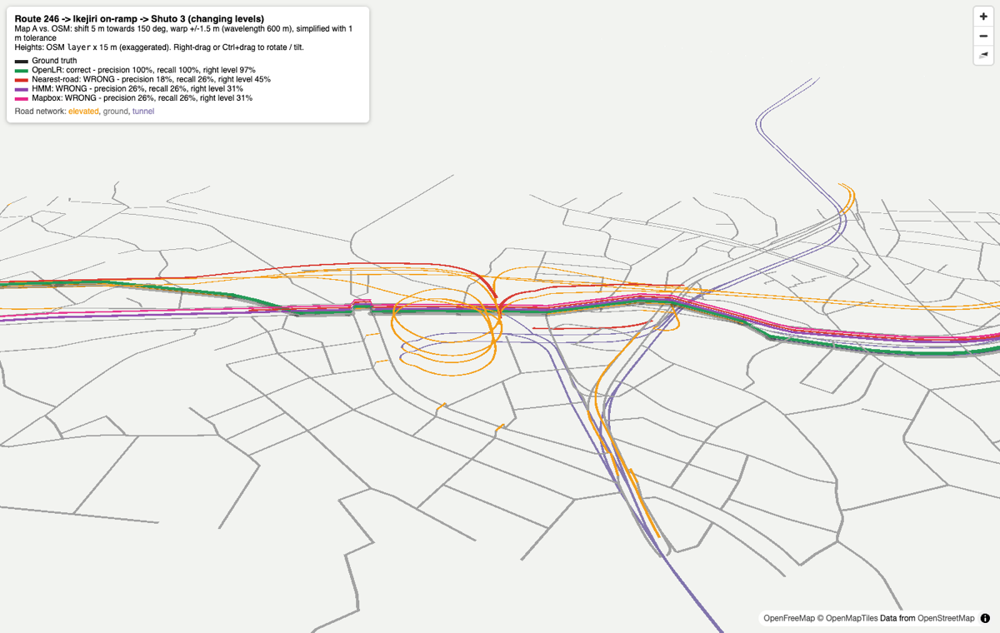

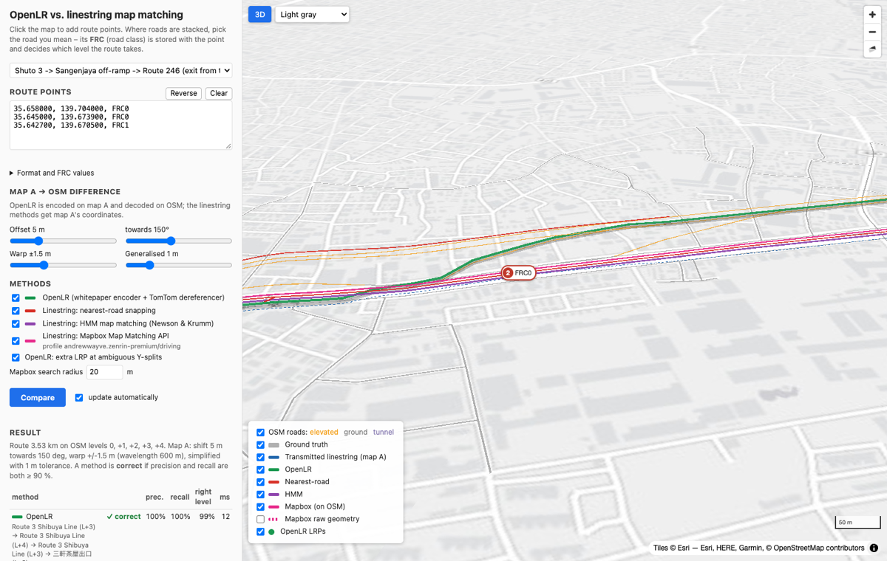

## Why the linestring matchers fail and OpenLR does not

* For stacked roads, the 2D geometry of the upper and lower road is practically the same.
  In OSM, the outbound Route 246 carriageway lies only about 6 m beside the outbound
  Shuto 3 carriageway, and the C2 tunnel lies about 3 m from Yamate-dori (median distances).
  With the default 5 m offset, the transmitted Shuto 3 linestring is 1.4 m from Route 246
  but 4.8 m from Shuto 3. The HMM therefore matches the whole route onto Route 246
  (precision 0 %): both paths are equally plausible to the transition model, and the
  emission model prefers the closer road.
* OpenLR's first LRP says *FRC0 / MOTORWAY, bearing 266°*. Route 246 and Roppongi-dori lines
  are within the decoder's search radius, and some are closer to the transmitted
  coordinate. Their FRC and FOW scores are lower, though: Shuto 3 lines rate 0.98, the
  surface roads 0.75–0.82. The decoder tries the best pair first, and the shortest path
  between the two Shuto 3 candidates matches the transmitted DNP (3013 m), so it is
  accepted. The geometric error only lowers the distance part of the rating, which is one
  quarter of it.
* The C2 tunnel is the control case in the demo run. The default offset direction (150°)
  is mostly *along* the southbound route there, so the linestring stays closer to the
  tunnel than to Yamate-dori (1.8 m against 3.4 m). In the sweep, which tries all
  directions, HMM also fails on C2 from about 8 m on. Even in the demo run,
  nearest-road snapping briefly jumps onto Yamate-dori.
* Mapbox matches on its own, carefully built road graph, but like the other linestring
  matchers it only receives coordinates. At the 5 m offset its answers for Shuto 3 and the
  C2 tunnel are confident (0.98) and wrong: `trunk` (Route 246) and `primary` (Yamate-dori).
  On C2 our plain HMM does better (correct up to 6 m in the sweep, Mapbox 58 % from 6 m on).
  On the ramp route Mapbox misses the on-ramp in 8 of 12 runs even at a 0 m offset, where
  only the warp and generalisation differ.
* An off-ramp that only the viaduct connects to (`shuto3-exit`) does *not* give the
  linestring matchers enough context. Mapbox still answers `trunk` for the whole route
  and explains the ramp section as Route 246. The ramp stays within 8–15 m of Route 246
  until it merges, so matching those points to the ground road costs little. In the sweep,
  Mapbox and HMM score the same as on `shuto3-elevated` up to 10 m, and Mapbox worse
  beyond that (25 % against 58 % at 20 m). A ramp could only force the right level if it
  diverged from the lower road by more than the search radius.
* The ramp scenario shows why step 8 matters. The Ikejiri on-ramp splits off Route 246
  through two `trunk_link` roads with the same FRC, FOW and nearly the same bearing. Without
  the extra LRP (`--no-disambiguation`), the decoder picks the wrong branch at a 5 m offset.
  This case is covered by `tests/test_scenarios.py`.

## Limitations and honest caveats

* **The sender map is simulated.** Real maps also differ in topology (missing or split
  junctions, different carriageway modelling), which this demo does not test. OpenLR is
  designed for such differences, but the results above say nothing about them.
* **FRC and FOW come from OSM tags** on both sides, so they agree perfectly. Between real
  vendors, the classification differs; the decoder's LFRCNP tolerance and FOW stand-in
  scores exist for that reason.
* **No turn restrictions** are used in routing on either side.
* **Mapbox works on a different map.** For the ZENRIN profile that is ZENRIN data, while the
  ground truth is OSM. The transfer to OSM uses Mapbox's road classes and tunnel flags; the
  ZENRIN `layer` values in the tracepoints (e.g. −20, 11, 15) are not used, because their
  meaning is undocumented. Results depend on the profile and on Mapbox's current
  data and algorithms. The cache in `output/.cache/mapbox/` keeps runs reproducible; delete
  it to query again.
* **The baselines only see geometry.** A linestring matcher that also transmits road
  class, heading and distance would do better, but at that point it is re-inventing
  OpenLR, just without a standard format.
* **The Mapbox decoder is a reconstruction.** Mapbox has no OpenLR decoder, so the split view
  builds one from Tilequery and Directions. Its decisions depend on Mapbox's routing cost
  (travel time, tolls, turn costs), which OpenLR does not model. The Mapbox Streets basemap
  and the ZENRIN routing graph can also differ in detail.
* **Valhalla is the public FOSSGIS server by default** ([usage policy](https://valhalla1.openstreetmap.de):
  fair use, at most one request per second). Its OSM data can be newer than the bundled
  extract. A route that leaves the extract is rejected with a hint to rebuild it.
* **Heights in the 3D view** are OSM `layer` × 15 m, purely illustrative.
* **Only line locations** are implemented, not point or area locations.

## Project layout

```
pyproject.toml            uv + Poetry (PEP 621, poetry-core backend)
data/shibuya_osm.json.gz  bundled OSM extract (drivable roads, bbox 139.655,35.633 – 139.712,35.672)
src/openlr_demo/
  network.py     directed road graph, FRC/FOW/level mapping, Dijkstra, spatial index
  encoder.py     OpenLR line encoder (whitepaper 11.1)
  decoder.py     MapReader adapter for openlr-dereferencer
  matchers.py    nearest-road and HMM linestring matchers
  mapbox.py      Mapbox client (Map Matching, Directions, Tilequery, basemap tiles; cached), transfer to OSM
  mapbox_decoder.py  OpenLR decoder on the Mapbox map (Tilequery candidates + Directions legs)
  valhalla.py    Valhalla routing client (cached) and transfer of its routes onto OSM
  similarity.py  route similarity across maps (buffer F1, Hausdorff, Frechet, FRC/tunnel agreement)
  crossmap.py    round trip OSM -> OpenLR -> Mapbox and the `crossmap` report
  settings.py    environment / .env settings
  sender_map.py  simulated map differences (map A)
  scenarios.py   the stacked-road routes
  routing.py     ground truth from lat/lon + FRC points (browser app)
  evaluation.py  precision / recall / level metrics
  pipeline.py    one end-to-end run per route
  sweep.py       robustness sweep
  viz.py         Leaflet 2D map, deck.gl 3D view, matplotlib plots
  report.py      console and Markdown report
  webapp.py      `openlr-demo serve`: standard-library HTTP server, JSON API, Mapbox tile proxy
  static/        split view (index.html, split.js/css: MapLibre) and linestring comparison
                 (compare.html, app.js/css: MapLibre + deck.gl)
  osm_fetch.py   PBF download + extraction (pyosmium)
  cli.py         `openlr-demo` command
tests/           encoder on hand-built networks, end-to-end scenarios, point router, web API,
                 Mapbox on recorded answers (tests/data, no token needed), split view on
                 recorded Valhalla + Mapbox responses (tests/data/recorded, offline)
.env.example     Mapbox and Valhalla settings template (copy to the git-ignored .env)
docs/img/        screenshots used in this README
```

## Data and licence

The road data is © [OpenStreetMap contributors](https://www.openstreetmap.org/copyright),
available under the Open Database Licence (ODbL). It was extracted from the
[BBBike Tokyo extract](https://download.bbbike.org/osm/bbbike/Tokyo/); the replication
timestamp is stored in the file's `meta` block. `openlr-demo fetch-data` downloads the PBF
into `data/raw/` (git-ignored, about 90 MB) and rebuilds the extract. After an OSM update,
the scenario anchors in `scenarios.py` may need adjusting.

Basemaps: Esri (Light Gray Canvas, World Imagery), OpenStreetMap and OpenFreeMap, all
usable without an API key; in the split view's right half, Mapbox (© Mapbox © OpenStreetMap)
through the local proxy. Routing: Valhalla on the FOSSGIS public server. The recorded Mapbox
answers in `tests/data/` are trimmed to the fields the parser reads; `tests/data/recorded/`
holds unmodified Valhalla and Mapbox responses (no token) for the offline split-view tests.
